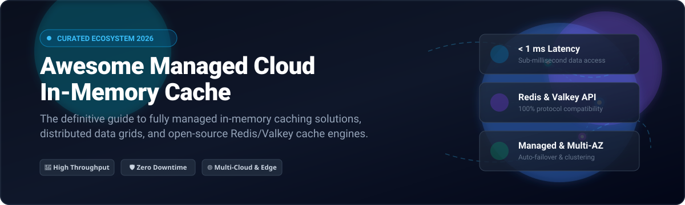

# ⚡ Awesome Managed Cloud In-Memory Cache

  <strong>Curated catalog of SaaS platforms and open-source distributed in-memory cache engines</strong> 
  <em>Engineered for sub-millisecond latency, distributed session management, high throughput, and real-time caching architecture.</em>

---

## 📑 Table of Contents

- [🌐 Sector Overview & Market Dynamics](#-sector-overview--market-dynamics)
- [☁️ SaaS / Hosted Platforms](#️-saas--hosted-platforms)
- [💻 Open-Source GitHub Projects](#-open-source-github-projects)
- [🛠️ Architectural Blueprints & Ecosystem Tools](#️-architectural-blueprints--ecosystem-tools)
- [🤝 How to Contribute](#-how-to-contribute)
- [📈 Star History](#--star-history)
- [⚖️ Disclaimer](#️-disclaimer)

---

## 🌐 Sector Overview & Market Dynamics

The global in-memory database and distributed caching market is estimated at **$7.5 billion in 2026** and is projected to expand beyond **$18 billion by 2031** (CAGR ~19.5%), propelled by exponential growth in real-time AI inference, LLM semantic cache layers, edge computing, and sub-millisecond fraud detection workflows. 

The industry demonstrates **moderate fragmentation transitioning toward hyperscaler consolidation**: while global public cloud hyperscalers (Amazon Web Services, Microsoft Azure, and Google Cloud) capture over 65% of enterprise production workloads through deeply integrated ecosystems, specialized modern caching vendors (such as Redis Ltd., Momento, Dragonfly, and Upstash) continuously capture high-growth market share by competing on serverless pay-per-request pricing, advanced multi-core throughput, vector search capabilities, and zero-ops developer ergonomics.

---

## ☁️ SaaS / Hosted Platforms

Below is a detailed comparison of fully managed in-memory cache cloud services, sorted descending by parent company enterprise valuation / annual revenue scale.

| Platform | Engine Support | Scale (Revenue / Valuation) | Pricing (Starting Tier) | Free Tier Limit / Free Trial | High-Availability & Highlights |
| :--- | :--- | :--- | :--- | :--- | :--- |
| **[Azure Cache for Redis](https://azure.microsoft.com/en-us/products/cache/)** | Redis OSS, Redis Enterprise | **~$245B Annual Revenue** (Microsoft) | **$16.06 / month** (Basic B0, 250 MB cache) | **$200 credit for 30 days** across Azure services + 12 months select free services | Multi-AZ clustering, Redis Enterprise active-active geo-replication, Flash SSD tiered memory. |
| **[Google Cloud Memorystore](https://cloud.google.com/memorystore)** | Valkey, Redis, Memcached | **~$350B Annual Revenue** (Alphabet) | **$0.019 / hour** (~$13.87/mo, Basic 1 GB Valkey instance) | **$300 free credits for 90 days** trial across Google Cloud products | Zero-downtime upgrades, ultra-low latency VPC peering, auto-failover high availability. |
| **[AWS ElastiCache](https://aws.amazon.com/elasticache/)** | Valkey, Redis OSS, Memcached | **~$108B AWS Revenue** (~$600B Amazon Total) | **$0.013 / hour** (~$9.50/mo, cache.t4g.micro Valkey node) | **750 hours/month of cache.t4g.micro** free for 12 months (AWS Free Tier) | Serverless automated scaling, Valkey multi-AZ replication, 99.99% SLA. |
| **[Heroku Key-Value Store](https://devcenter.heroku.com/articles/heroku-redis)** | Valkey / Redis | **~$35B Annual Revenue** (Salesforce) | **$3.00 / month** (Mini Plan, 25 MB storage, 20 max connections) | **$0/mo (Heroku Student/Nonprofit credits)**; 30-day trial via Salesforce credits | Native PaaS add-on integration, automated daily backups, background worker queueing. |
| **[Redis Cloud](https://redis.io/cloud/)** | Redis 8.4+ & Redis Stack | **~$4.0B Valuation** (Redis Ltd.) | **$5.00 / month** (Fixed plan, 250 MB RAM, 100 max connections) | **Free Forever: 30 MB RAM**, 30 max connections, 1 database, multi-cloud hosting | Active-Active geo-distribution (CRDTs), vector similarity search, 99.999% uptime guarantee. |
| **[Aiven for Valkey](https://aiven.io/valkey)** | Valkey (Open Source) | **~$3.0B Valuation** (Aiven) | **$0.024 / hour** (~$17.52/mo, Startup-1 plan, 1 node, 1 GB RAM) | **$300 free credits for 30 days** with full platform feature access | Multi-cloud deployments (AWS, GCP, Azure, DO), automated backup forks, TLS-only security. |
| **[Momento](https://www.gomomento.com/)** | Valkey / Redis compatible | **~$100M+ Valuation** (Series A Venture Backed) | **$0.50 / GB data transfer out** (Pay-as-you-go serverless) | **Free Forever: 50 GB/month data transfer**, up to 100 requests/sec | Instant zero-cluster serverless architecture, hot-key shielding, integrated HTTP webhooks. |
| **[Upstash Redis](https://upstash.com/)** | Redis / REST API | **~$80M Valuation** (Venture Backed) | **$0.20 per 100k commands** ($0.25/GB storage) | **Free Forever: 10,000 commands/day**, 256 MB data storage | Serverless edge caching, stateless HTTP/REST API endpoints, global active-active replication. |
| **[Dragonfly Cloud](https://www.dragonflydb.io/cloud)** | Dragonfly (Redis & Memcached API) | **~$50M Valuation** (Series A Venture Backed) | **$45.00 / month** (Developer Plan, 4 GB memory instance) | **14-day free trial** with full cloud enterprise features, up to 16 GB cache | Multi-threaded shared-nothing architecture, up to 25x Redis throughput, memory compaction. |
| **[ScaleGrid Redis](https://scalegrid.io/redis/)** | Redis OSS 3.2 – 7.4 | **~$15M Annual Revenue** | **$18.00 / month** (Micro dedicated instance, 1 GB RAM) | **7-day free trial** with dedicated cluster provisioning on AWS or Azure | Bring Your Own Cloud (BYOC) VPC peering, full root SSH & admin access, automated shard scaling. |

---

## 💻 Open-Source GitHub Projects

Curated collection of open-source in-memory caches, distributed data grids, and Kubernetes operators, sorted descending by GitHub star count.

| Project | Stars | License | Primary Language | Description & Key Strengths |
| :--- | :---: | :---: | :---: | :--- |
| **[Redis](https://github.com/redis/redis)** |  | RSALv2 / SSPL | C | The foundational in-memory key-value data structure store used globally for caching, streaming, and real-time analytics. |
| **[Dragonfly](https://github.com/dragonflydb/dragonfly)** |  | BSL-1.1 | C++ | Next-generation multithreaded in-memory store delivering 25x higher throughput and sub-millisecond latencies under high concurrency. |
| **[Valkey](https://github.com/valkey-io/valkey)** |  | BSD-3-Clause | C | High-performance open-source fork of Redis guided by the Linux Foundation with backing from AWS, Google, Oracle, and Ericsson. |
| **[Memcached](https://github.com/memcached/memcached)** |  | BSD-3-Clause | C | Battle-tested, minimalist distributed memory object caching system powering high-traffic web tiers for decades. |
| **[KeyDB](https://github.com/Snapchat/KeyDB)** |  | BSD-3-Clause | C++ | Multithreaded Redis fork developed by Snapchat utilizing all server CPU cores, active replication, and FLASH storage tiering. |
| **[Microsoft Garnet](https://github.com/microsoft/garnet)** |  | MIT | C# | Remote cache-store engineered by Microsoft Research offering extreme throughput, custom extensions, and native Redis client compatibility. |
| **[BigCache](https://github.com/allegro/bigcache)** |  | Apache-2.0 | Go | Ultra-fast in-memory cache for gigabytes of arbitrary entries avoiding GC overhead by utilizing raw off-heap byte buffers. |
| **[Ristretto](https://github.com/dgraph-io/ristretto)** |  | Apache-2.0 | Go | Memory-bound, concurrent Go cache focused on exceptional hit ratios using TinyLFU admission and eviction policies. |
| **[Hazelcast](https://github.com/hazelcast/hazelcast)** |  | Apache-2.0 / Commercial | Java | Real-time stream processing engine and distributed in-memory data grid (IMDG) with auto-clustering and WAN replication. |
| **[FreeCache](https://github.com/coocood/freecache)** |  | MIT | Go | Zero-GC overhead in-memory Go cache capable of storing hundreds of millions of keys with ring-buffer segmentation. |
| **[Apache Ignite](https://github.com/apache/ignite)** |  | Apache-2.0 | Java | Distributed in-memory computing database and caching platform with ACID transaction support, ANSI-99 SQL, and machine learning APIs. |
| **[Cache2go](https://github.com/muesli/cache2go)** |  | MIT | Go | Concurrency-safe Go caching library supporting automated TTL expiration callbacks and internal access counters. |
| **[Spotahome Redis Operator](https://github.com/spotahome/redis-operator)** |  | Apache-2.0 | Go | Battle-tested Kubernetes operator to deploy, configure, and manage high-availability Redis Failover clusters with Sentinel. |
| **[OT-CONTAINER-KIT Redis Operator](https://github.com/OT-CONTAINER-KIT/redis-operator)** |  | Apache-2.0 | Go | Production-grade operator overseeing standalone, Redis cluster, and Sentinel replication topologies on Kubernetes. |
| **[Valkey Operator](https://github.com/valkey-io/valkey-operator)** |  | Apache-2.0 | Go | Official community Kubernetes operator for declarative deployment, automated clustering, and rolling lifecycle updates of Valkey. |
| **[Alauda Redis Operator](https://github.com/alauda/redis-operator)** |  | Apache-2.0 | Go | Kubernetes operator for enterprise Redis cluster lifecycle orchestration, online shard rebalancing, and backup management. |
| **[GValkey](https://github.com/PlayerNeo42/gvalkey)** |  | MIT | Go | Lightweight educational in-memory key-value cache implementing Redis serialization protocol (RESP) and concurrent-safe hash tables. |

---

## 🛠️ Architectural Blueprints & Ecosystem Tools

### 🏗️ Recommended Production Cache Stacks

- **Cloud-Native Kubernetes Managed Stack**:
  - **Storage Engine**: [Valkey](https://github.com/valkey-io/valkey) or [Dragonfly](https://github.com/dragonflydb/dragonfly)
  - **Orchestration**: [Valkey Operator](https://github.com/valkey-io/valkey-operator) or [OT-CONTAINER-KIT Redis Operator](https://github.com/OT-CONTAINER-KIT/redis-operator)
  - **Metrics & Observability**: [Prometheus Redis Exporter](https://github.com/oliver006/redis_exporter) + [Grafana Dashboards](https://grafana.com/grafana/dashboards/763)
  - **Client Libraries**: `redis-py`, `lettuce`, `go-redis`, or `ioredis` with client-side caching enabled.

- **Serverless & Edge Compute Stack**:
  - **Primary Cache**: [Upstash Redis](https://upstash.com/) or [Momento](https://www.gomomento.com/)
  - **Runtime**: Cloudflare Workers, AWS Lambda, Vercel Edge Functions, or Next.js middleware.

---

## 🤝 How to Contribute

Contributions are welcome and highly appreciated! 💖

1. 🍴 Fork the repository.
2. 🌿 Create your feature branch (`git checkout -b feature/add-new-cache-tool`).
3. 📝 Add your entries to `README.md` following the established table formats.
4. ✨ Ensure descriptions are objective, fact-checked, and include direct documentation links.
5. 🚀 Submit a Pull Request with a clear description of your additions.

---

## 📈 Star History

---

## ⚖️ Disclaimer

- This repository is a community-curated, vendor-neutral educational resource.
- Product logos, trademarks, and company valuations are property of their respective owners.
- Cloud pricing and free tiers are subject to change; always review provider pricing documentation before production deployments.

---

  Built with ❤️ by platform engineers, SREs, and distributed systems developers worldwide.

